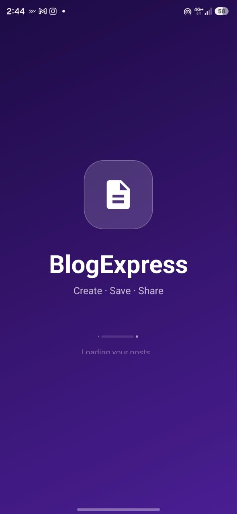
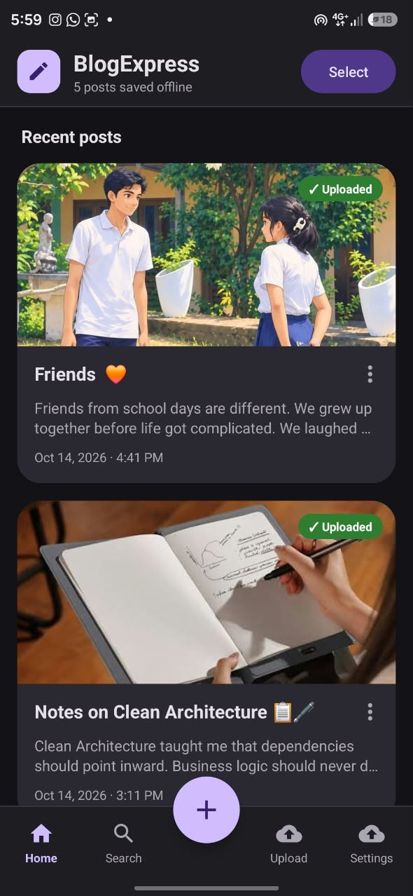
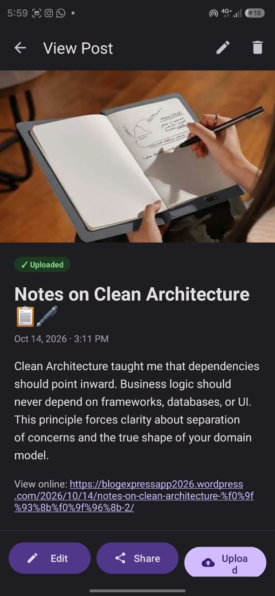
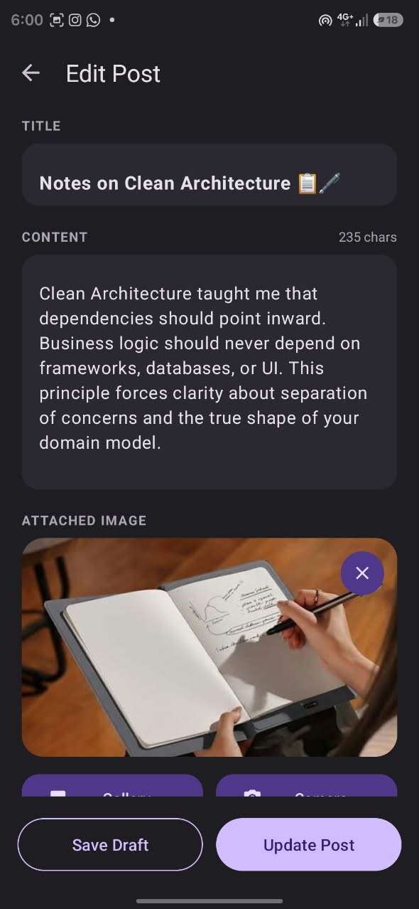
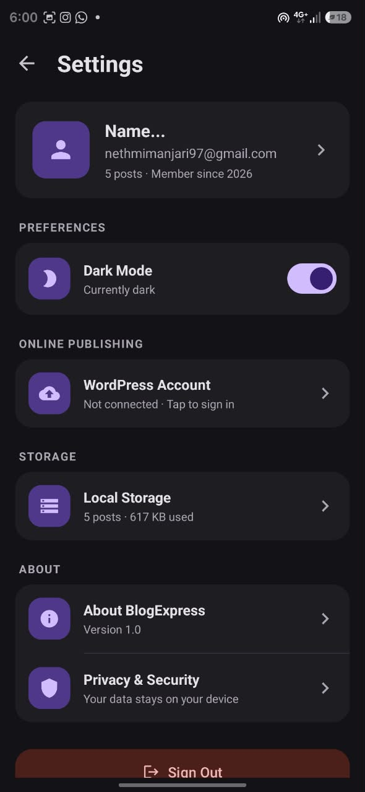

BlogExpress 📝

An offline-first Android blogging app with WordPress.com publishing.

BlogExpress lets you write, edit, search and manage blog posts completely offline, attach photos from your gallery or camera, share posts by email, and publish one or many posts to your personal WordPress.com blog when you are back online.

> Developed in Java with Android Studio for the module 6CS027 – Secure Mobile Application Development.


✨ Features

Offline post management
- Create, edit and view posts without an internet connection
- Save posts as drafts or publish them
- Live search through titles and content
- Delete a single post or select multiple posts and delete them together
- All posts stored locally in an SQLite database

Photos
- Attach photos from the gallery (Android Photo Picker – no storage permission needed)
- Take photos with the camera (via FileProvider)
- Automatic resizing and EXIF-based rotation

Sharing & publishing
- Share a post with its photo by email using the Android Share sheet
- Upload a single post, a selected group or all pending posts to WordPress.com
- Drafts are uploaded as WordPress drafts
- "Uploaded" badge and link to the online post

User experience
- Material 3 design with light and dark mode
- Animated splash screen
- Bottom navigation: Home · Search · Upload · Settings
- Profile and local storage information in Settings


📸 Screenshots

| Splash | Home | Post | Edit | Settings |
|:---:|:---:|:---:|:---:|:---:|
|  |  |  |  |  |


🛠️ Tech Stack

| Area | Technology |
|---|---|
| Language | Java |
| IDE | Android Studio |
| Minimum SDK | 21 (Android 5.0) |
| Target SDK | 36 |
| Local database | SQLite (`SQLiteOpenHelper`) |
| Networking | OkHttp 4.12.0 |
| UI | Material Components 1.12.0, RecyclerView |
| Online platform | WordPress.com REST API v1.1 + OAuth2 |


🚀 Getting Started

Requirements
- Android Studio (latest stable version)
- Android device or emulator running Android 5.0 (API 21) or later

Run the app
1. Clone the repository
   ```bash
   git clone https://github.com/<your-username>/<your-repo-name>.git
   ```
2. Open the project folder in Android Studio (`File → Open`)
3. Wait for Gradle sync to finish
4. Connect an Android phone with USB debugging enabled (or start an emulator)
5. Click ▶ Run


🌐 Connecting WordPress.com

1. Create a free blog at [wordpress.com](https://wordpress.com)
2. Create an application at [developer.wordpress.com/apps](https://developer.wordpress.com/apps)
   - Redirect URL: `https://localhost`
   - Type: Native
3. Copy the Client ID** and Client Secret
4. In the app, open Settings → WordPress Account and enter:
   - Site (e.g. `yourblog.wordpress.com`)
   - Client ID and Client Secret
   - WordPress.com username/email and password
5. Tap Connect & Save

Your password is used only once to obtain an OAuth access token and is never stored on the device.

🔒 Security

| Risk | Measure |
|---|---|
| SQL injection | Parameterised queries with `?` placeholders |
| Exposure of private photos | Private app storage; FileProvider with temporary read permission |
| Password theft | Password used once over HTTPS; only the OAuth token is stored |
| Intercepted traffic | HTTPS only (`usesCleartextTraffic="false"`) |
| Cloud backup exposure | `allowBackup="false"` |
| Script injection on the blog | Post text is HTML-escaped before upload |
| Unnecessary permissions | Photo Picker and camera intent instead of storage/camera permissions |
| Exposed components | Only the launcher activity is exported |

 📁 Project Structure

```
app/src/main/
├── java/uk/ac/wlv/blogexpress/
│   ├── BlogExpressApp.java        # Applies saved theme at startup
│   ├── SplashActivity.java        # Animated splash screen
│   ├── MainActivity.java          # Post list, search, upload tab, selection mode
│   ├── EditMessageActivity.java   # Create / edit posts, photos, drafts
│   ├── ViewMessageActivity.java   # Post details, share, upload, delete
│   ├── SettingsActivity.java      # Profile, dark mode, storage, privacy
│   ├── AccountActivity.java       # WordPress.com sign-in
│   ├── MessageAdapter.java        # RecyclerView adapter with multi-select
│   ├── Message.java               # Post model
│   ├── DatabaseHelper.java        # SQLite CRUD + search
│   ├── ImageUtils.java            # Photo resize, rotation, FileProvider URIs
│   ├── UiUtils.java               # Edge-to-edge, dialogs, sharing
│   ├── SettingsManager.java       # Private SharedPreferences
│   ├── WordPressUploader.java     # WordPress.com REST API (HTTPS)
│   └── SampleData.java            # Demo posts on first launch
├── res/
│   ├── layout/                    # Screens and list item layouts
│   ├── drawable/                  # Vector icons and shapes
│   ├── menu/                      # Toolbar and card menus
│   ├── values/ & values-night/    # Colours, themes (light & dark)
│   └── xml/                       # FileProvider paths, backup rules
└── AndroidManifest.xml
```

🗄️ Database

Table: `messages`

| Column | Type | Description |
|---|---|---|
| `id` | INTEGER | Primary key, autoincrement |
| `title` | TEXT | Post title |
| `content` | TEXT | Post body |
| `image_path` | TEXT | Path of the attached photo |
| `created_at` | INTEGER | Creation time (ms) |
| `updated_at` | INTEGER | Last edit time (ms) |
| `uploaded` | INTEGER | 1 when published online |
| `remote_url` | TEXT | Link to the online post |
| `is_draft` | INTEGER | 1 when saved as a draft |

📦 Third-Party Libraries

| Library | Version | Licence |
|---|---|---|
| [OkHttp](https://square.github.io/okhttp/) | 4.12.0 | Apache 2.0 |
| Material Components for Android | 1.12.0 | Apache 2.0 |
| AndroidX AppCompat | 1.7.0 | Apache 2.0 |
| AndroidX Core / Activity | 1.13.1 / 1.9.3 | Apache 2.0 |
| AndroidX RecyclerView | 1.3.2 | Apache 2.0 |
| AndroidX ExifInterface | 1.3.7 | Apache 2.0 |


🔮 Future Improvements

- Sync posts that are edited after uploading
- Browser-based OAuth sign-in instead of the password grant
- Encrypt the access token with the Android Keystore
- Automated JUnit and Espresso tests

👤 Author

Nethmi Manjari
Software Engineering undergraduate
[LinkedIn](https://www.linkedin.com/in/nethmi-manjari) · [GitHub](https://github.com/nethmimanjari)

